

# Analiza porównawcza wybranych architektur Deep Learning w zadaniu semantycznej segmentacji chmur punktów LiDAR w leśnictwie, wraz z analizą wpływu danych syntetycznych oraz rzeczywistych

**Autorzy:**  
Łukasz Słowik, Karol Pietruszka

---

**Przedmiot:** Wprowadzenie do sztucznej inteligencji  
**Kierunek:** Geomatyka i AI w Leśnictwie  
**Data:** Czerwiec/Lipiec 2026

---

# 1. Przygotowanie danych

Proces przygotowania danych do celów projektowych obejmował integrację rzeczywistych chmur punktów LiDAR ze zbiorami syntetycznymi oraz ich ustrukturyzowany podział na podzbiory procesowe.

## 1.1. Wykorzystane dane

W projekcie wykorzystano dwa główne źródła danych:

1.  **Zbiór ForInstance v1**: 
    *   Repozytorium danych: [Zenodo (8287792)](https://zenodo.org/records/8287792)
    *   Artykuł: [arXiv:2309.01279](https://arxiv.org/pdf/2309.01279)
2.  **Zbiór syntetyczny**:
    *   **Środowisko generacji**: Środowisko grafiki 3D [Blender](https://www.blender.org/) sterowane autorskim skryptem Python.
    *   **Geometria obiektów**: Do budowy scen wykorzystano modele 3D drzew wygenerowane w oprogramowaniu [TreeIt](https://www.evolved-software.com/treeit/treeit).

## 1.2. Podział na podzbiór treningowy, walidacyjny i testowy:

Zbiór danych ForInstance v1 został poddany podziałowi na trzy części: treningową, walidacyjną oraz testową. Przy podziale nie zagłębiano się szczegółowo w specyfikę każdej sceny z osobna - skupiono się na bardziej na tym, żeby każda paczka danych (CULS, NIBIO, RMIT, SCION, TUWIEN) miała swoją reprezentację w treningu i walidacji/teście.

### 1.2.1. Podzbiór Treningowy (TRAIN) – 19 scen

*   CULS_plot_1_annotated.las
*   NIBIO_plot_1_annotated.las
*   NIBIO_plot_2_annotated.las
*   NIBIO_plot_4_annotated.las
*   NIBIO_plot_5_annotated.las
*   NIBIO_plot_7_annotated.las
*   NIBIO_plot_8_annotated.las
*   NIBIO_plot_10_annotated.las
*   NIBIO_plot_11_annotated.las
*   NIBIO_plot_13_annotated.las
*   NIBIO_plot_16_annotated.las
*   NIBIO_plot_18_annotated.las
*   NIBIO_plot_19_annotated.las
*   NIBIO_plot_22_annotated.las
*   RMIT_train.las
*   SCION_plot_31_annotated.las
*   SCION_plot_39_annotated.las
*   SCION_plot_87_annotated.las
*   TUWIEN_train.las

### 1.2.2. Podzbiór Walidacyjny (VAL) – 4 sceny
*   NIBIO_plot_3_annotated.las
*   NIBIO_plot_9_annotated.las
*   NIBIO_plot_17_annotated.las
*   SCION_plot_35_annotated.las

### 1.2.3. Podzbiór Testowy (TEST) – 7 scen
*   NIBIO_plot_12_annotated.las
*   NIBIO_plot_21_annotated.las
*   NIBIO_plot_23_annotated.las
*   NIBIO_plot_6_annotated.las
*   RMIT_test.las
*   SCION_plot_61_annotated.las
*   TUWIEN_test.las

---

# 2. Preprocessing

Proces przygotowania danych do treningu został zrealizowany za pomocą czterech notatników Jupyter, umieszczonych w katalogu `preprocessing`.

## 2.1. Notatnik 01: Indeksowanie danych (`01_data_indexing`)
Pierwszym etapem było nadanie unikalnego identyfikatora (ID) każdemu punktowi w obrębie paczki danych, celem zapewnienia korelacji między punktami wejściowymi a wynikami segmentacji. Docelowo pomysł ma służyć przypisaniu wyników predykcji do oryginalnych chmur punktów na etapie postprocessingu.

## 2.2. Notatnik 02: Ciecie datasetu (`02_data_tiling.ipynb`)
Etap ten obejmował podział scen na mniejsze patche/kafelki do przetwarzania przez sieci neuronowe. 

### Parametry geometryczne cięcia:
*   **Rozmiar kafelka (PATCH_SIZE)**: 20.0 m x 20.0 m.
*   **Krok przesunięcia (STRIDE)**: 10.0 m (50% zakładki między sąsiednimi kafelkami).
*   **Metoda**: Proste cięcie w układzie siatki kwadratów, bez zaawansowanej filtracji obiektów brzegowych. 

### Selekcja i filtracja punktów:
*   **Wykluczenie klasy 3 (Out-points)**: Usunięte zostały punkty zaklasyfikowanych jako "Out Points" (https://arxiv.org/pdf/2309.01279), które często reprezentowały fragmenty drzew (a miejscami praktycznei całe dzrewa) na krawędziach scen.
*   **Limity liczności (MIN/MAX_TOTAL_POINTS)**: 
    *   Kafelki zawierające mniej niż **100 punktów** były odrzucane jako nieistotne statystycznie.
    *   W przypadku kafelków przekraczających **50 000 punktów**, stosowano losowy subsampling (podpróbkowanie) w celu redukcji rozmiaru danych.

## 2.3. Notatnik 03: Reklasyfikacja semantyczna (`03_data_relabeling.ipynb`)
Oryginalna klasyfikacja danych (7 klas) została uproszczona do 3-klasowego modelu docelowego.

**Schemat mapowania etykiet:**

| Oryginalny kod klasy | Nazwa klasy pierwotnej | Nowy kod klasy | Nazwa klasy docelowej |
| :--- | :--- | :---: | :--- |
| 0, 1, 2 | Unclassified, Low-veg, Terrain | **0** | **Tło (Background)** |
| 4 | Stem | **1** | **Pień (Trunk)** |
| 5, 6 | Live branches, Woody branches | **2** | **Korona (Tree Crown)** |

*Klasa 3 (Out-points) została trwale usunięta na etapie kafelkowania.*

## 2.4. Notatnik 04: Weryfikacja zbioru danych (`04_dataset_check.ipynb`)
Ostatnim etapem była kontrola jakościowa przetworzonych danych, poprzez generowanie rzutów 3D z użyciem biblioteki Matplotlib.
Skrytpt umożliwia wizualne sprawdzenie poprawności labelingu i mapowania klas, jak na ilustracji poniżej.

  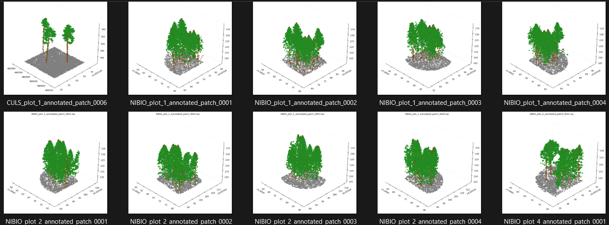
   
  <em>Weryfikacja poprawności etykietowania i spójności kafelków.</em>

---

# 3. Środowisko i proces treningowy

Proces wytrenowania modeli segmentacyjnych został zaprojektowany z myślą o elastyczności i możliwości testowania różnych architektur w ograniczonym budżetowo środowisku obliczeniowym.

## 3.1. Platforma obliczeniowa i infrastruktura

Głównym środowiskiem obliczeniowym była platforma **Paperspace Gradient** (https://www.paperspace.com/). Wybór ten podyktowany był możliwością pracy na "czystym" systemie Ubuntu, co było kluczowe dla poprawnej kompilacji i instalacji specyficznych bibliotek 3D.

*   **Główna platforma**: Paperspace (maszyna "Start from Scratch").
*   **Wsparcie dodatkowe**: Google Colab (wymaga dostosowaniu ścieżek w notatniku w sekcji 'System Setup', umożliwia pracę tylko na  bakcbone PointNext oraz PointNet++).
*   **Specyfikacja sprzętowa**:
    *   **GPU**: NVIDIA Quadro RTX 5000 (Architektura Turing, sm_75, 16GB VRAM).
    *   **CUDA**: Wersja 12.4.
*   **Konfiguracja**: Szczegółowy opis przygotowania środowiska (instalacja sterowników i zależności) został zawarty w osobnym dokumencie: `paperspace_environment_setup.md`.

## 3.2. Wykorzystane biblioteki

Rdzeń systemu treningowego oparto na trzech kluczowych bibliotekach dedykowanych przetwarzaniu chmur punktów i rzadkich struktur danych:

1.  **PyTorch Geometric (https://github.com/pyg-team/pytorch_geometric)**: Wykorzystana do większości zadań związanych z przygotowaniem danych, implementacją transformacji przestrzennych czy budową Dataloaderów.
2.  **SpConv (https://github.com/traveller59/spconv)**: Zastosowana jako silnik dla backbone oparego na rzadkich splotach 3D.
3.  **PointTransformerV3 (https://github.com/pointcept/pointtransformerv3)**: Zastosowana jako silnik dla backbone oparego na PTv3.

## 3.3. Założenia notatnika treningowego

Głównym założeniem opracowanego notatnika było stworzenie modularnego środowiska do szybkiego prototypowania i testowania różnych wariantów sieci neuronowych. System pozwala na łatwą zmianę:
*   Architektury sieci (backbone).
*   Rozmiaru modelu (liczba kanałów, głębokość sieci).
*   Hiperparametrów treningowych w ramach segmentacji semantycznej drzew.

## 3.4. Architektura i konfiguracja eksperymentu (`CFG_DICT`)

System treningowy został w pełni sparametryzowany za pomocą słownika konfiguracyjnego `CFG_DICT`, celem zapewnia powtarzalności eksperymentów oraz wygodnego przełączania się między architekturami.

### 3.4.1. Modułowość Backbone
Notatnik wspiera cztery zróżnicowane pod względem technologicznym architektury:
*   **PointNet++**: Wykorzystujący moduły *Set Abstraction* i *Feature Propagation* z ręczną implementacją FPS (*Farthest Point Sampling*) i KNN.
*   **PointNeXt**: Wersja PointNet++, wprowadzająca bloki *Inverted Residual*.
*   **SpConv**: Architektura oparta na splotach rzadkich (Sparse Convolutions).
*   **PTv3 (Point Transformer v3)**: Model wykorzystujący mechanizm Attention.

### 3.4.2. Strategia optymalizacji i funkcje celu
W procesie uczenia zaimplementowano mechanizmy stabilizacji gradientu:
*   **Funkcja straty (DiceFocalLoss)**: Hybrydowe połączenie *Focal Loss* (skupiającej się na trudnych punktach, np. pniach) oraz *Dice Loss* (optymalizującej globalne nakładanie się klas/IoU). Zastosowano również *Label Smoothing* (0.15) dla lepszej generalizacji. 
*   **Optymalizator**: AdamW z wagowym zanikaniem gradientu (*weight decay*).
*   **Harmonogram uczenia (Scheduler)**: Wykorzystano `CosineAnnealingLR` poprzedzony 5-epokowym etapem rozgrzewki (*Warmup*).

## 3.5. Augmentacja danych (Domain-Specific Augmentation)

Projekt posiada potok augmentacj z założenia dostosowany do specyfiki danych LiDAR w leśnictwie. Poza standardowymi rotacjami i skalowaniem, zaimplementowano transformacje symulujące realne warunki terenowe (skupiono się na transformacjach bardziej semantycznych, pomięte zostały modyfikacji pojedynczych instancji):
*   **Random Slope**: Symulacja nachylenia terenu.
*   **Semantic Stem Stretch**: Dynamiczne rozciąganie pni drzew przy zachowaniu spójności z koroną.
*   **Class Local Density Change**: Losowa redukcja gęstości punktowej w obrębie konkretnych klas (np. rzadsze punkty na pniu), symulująca zmienne warunki skanowania.
*   **Forest Geometry Thickener**: Selektywne zagęszczanie punktów klasy "pień" poprzez jittering, mające na celu wzmocnienie reprezentacji geometrycznej najtrudniejszej klasy.
*   **Elastic Distortion**: Nieliniowe odkształcenia przestrzenne chmury punktów.

Przykład augmentacji zostaje załączony poniżej:

**Przykład augmentacji 1**  
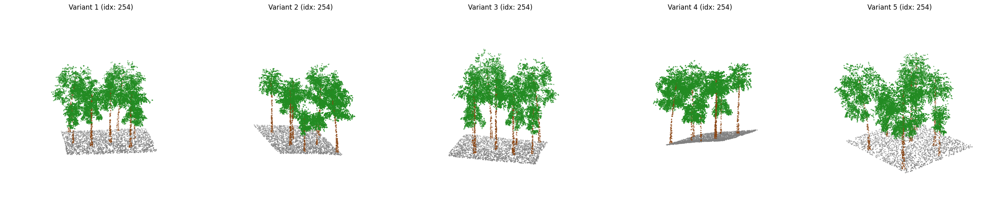

**Przykład augmentacji 2**  
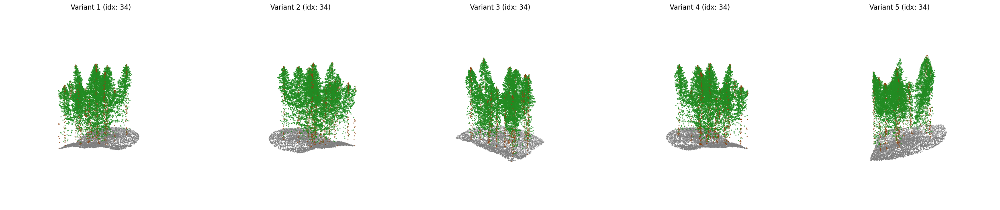

**Przykład augmentacji 3**  
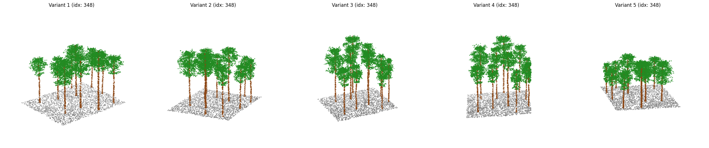

## 3.6. Monitoring i Logging (Weights & Biases)

Proces uczenia jest w pełni zintegrowany z platformą **Weights & Biases (WandB)**. System loguje w czasie rzeczywistym:
*   Metryki segmentacji: mIoU, F1-score, Precision i Recall (zarówno globalnie, jak i per-class).
*   Wizualizacje 3D: 
*   Checkpionting: Automatyczne zapisywanie wag modelu dla najlepszego wyniku metryki `val/mIoU`.

## 3.7. Zakres eksperymentów i ograniczenia

Ze względu na pilotażowy charakter projektu oraz ograniczenia czasowe, przeprowadzono selektywną liczbę sesji treningowych. Proces optymalizacji hiperparametrów skupił się na kluczowych parametrach (learning rate, batch size) i dosłownie kilku treningach.

*   **PointNet++ i PointNeXt**: Modele te zostały poddane pojedynczym próbom testowym (glówie ze względu na relatywnie długi cza treningu, a w przypadku PointNet++ również ze względu na słabegy wynik).
*    **SpConv i PTv3**: Tutaj dodatkowo zostały wykonane pojedyncze testy wykorzystujące dataset syntetyczny w treningu oraz połączenie datasetu syntetycznego z rzeczywistym.

---

# 4. Wyniki i Analiza Eksperymentów

W tej sekcji przedstawiono zestawienie wyników uzyskanych dla testowanych konfiguracji modeli. Analiza obejmuje zarówno zbór testowy (7 scen) oraz walidacyjny (4 sceny).

## 4.1. Wyniki szczegółowe na zbiorze testowym (7 scen)

Poniższa tabela zawiera raporty klasyfikacji dla trzech zdefiniowanych klas: Tło (0), Pień (1) oraz Korona (2).

| Model | Zbiór danych | Klasa | Precision | Recall | F1-score | Accuracy |
| :--- | :--- | :--- | :---: | :---: | :---: | :---: |
| **PointNet++** | Real | background | 0.9649 | 0.9766 | 0.9707 | **0.9265** |
| | | trunk | 0.2702 | 0.3120 | 0.2896 | |
| | | tree_crown | 0.9618 | 0.9490 | 0.9553 | |
| **PointNext** | Real | background | 0.9878 | 0.9677 | 0.9777 | **0.9167** |
| | | trunk | 0.3245 | 0.7300 | 0.4493 | |
| | | tree_crown | 0.9814 | 0.9122 | 0.9455 | |
| **SpConv** | Real | background | 0.9921 | 0.9581 | 0.9748 | **0.9314** |
| | | trunk | 0.3782 | 0.6950 | 0.4898 | |
| | | tree_crown | 0.9771 | 0.9375 | 0.9569 | |
| **SpConv** | Synth | background | 0.9889 | 0.9559 | 0.9721 | **0.9437** |
| | | trunk | 0.4609 | 0.5262 | 0.4914 | |
| | | tree_crown | 0.9639 | 0.9655 | 0.9647 | |
| **SpConv** | **Real+Synth** | background | 0.9858 | 0.9839 | 0.9849 | **0.9415** |
| | | trunk | 0.4238 | 0.7184 | 0.5332 | |
| | | tree_crown | 0.9831 | 0.9419 | 0.9621 | |
| **PTv3** | Real | background | 0.9891 | 0.9729 | 0.9809 | **0.9324** |
| | | trunk | 0.3842 | 0.7406 | 0.5059 | |
| | | tree_crown | 0.9824 | 0.9316 | 0.9563 | |
| **PTv3** | Synth | background | 0.9877 | 0.9647 | 0.9760 | **0.9433** |
| | | trunk | 0.4375 | 0.4880 | 0.4614 | |
| | | tree_crown | 0.9647 | 0.9648 | 0.9648 | |
| **PTv3** | **Real+Synth** | background | 0.9811 | 0.9855 | 0.9833 | **0.9465** |
| | | trunk | 0.4565 | 0.6469 | 0.5353 | |
| | | tree_crown | 0.9793 | 0.9528 | 0.9659 | |

## 4.2. Zbiorcze zestawienie wyników walidacyjnych (4 sceny)

Metryki uzyskane na zbiorze walidacyjnym (WandB Run Summary). Z uwagi na wysokie wyniki dla klasy tłą i korony kluczowym wskaźnikiem wydaje się być mIoU klasy Trunk.

| Model | Zbiór | Val Acc | Val mF1 | Val mIoU | IoU Bkgr. | IoU Crown | IoU Trunk |
| :--- | :--- | :---: | :---: | :---: | :---: | :---: | :---: |
| **PointNet++** | Real | 0.8559 | 0.6944 | 0.6349 | 0.9701 | 0.8282 | 0.1065 |
| **PointNext** | Real | 0.9207 | 0.7888 | 0.7187 | 0.9814 | 0.9041 | 0.2706 |
| **SpConv** | Real | 0.9212 | 0.8015 | 0.7294 | 0.9822 | 0.9040 | 0.3021 |
| **SpConv** | Synth | 0.9474 | 0.8059 | 0.7385 | 0.9785 | 0.9376 | 0.2993 |
| **SpConv** | **Real+Synth** | 0.9436 | **0.8281** | **0.7577** | 0.9825 | 0.9314 | **0.3593** |
| **PTv3** | Real | 0.9337 | 0.8161 | 0.7451 | 0.9840 | 0.9193 | 0.3320 |
| **PTv3** | Synth | **0.9492** | 0.8010 | 0.7350 | 0.9794 | **0.9402** | 0.2856 |
| **PTv3** | **Real+Synth** | 0.9448 | **0.8274** | **0.7579** | **0.9854** | 0.9332 | 0.3550 |

## 4.3. Analiza macierzy konfuzji (Confusion Matrices)

Poniżej przedstawiono zestawienie macierzy konfuzji (7 scen testowych) dla wszystkich przetestowanych wariantów, pogrupowanych według architektury i wykorzystanego zbioru danych.

### Grupa 1: Architektury bazowe (Baseline)
| PointNet++ (Real) | PointNeXt (Real) |
| :---: | :---: |
| 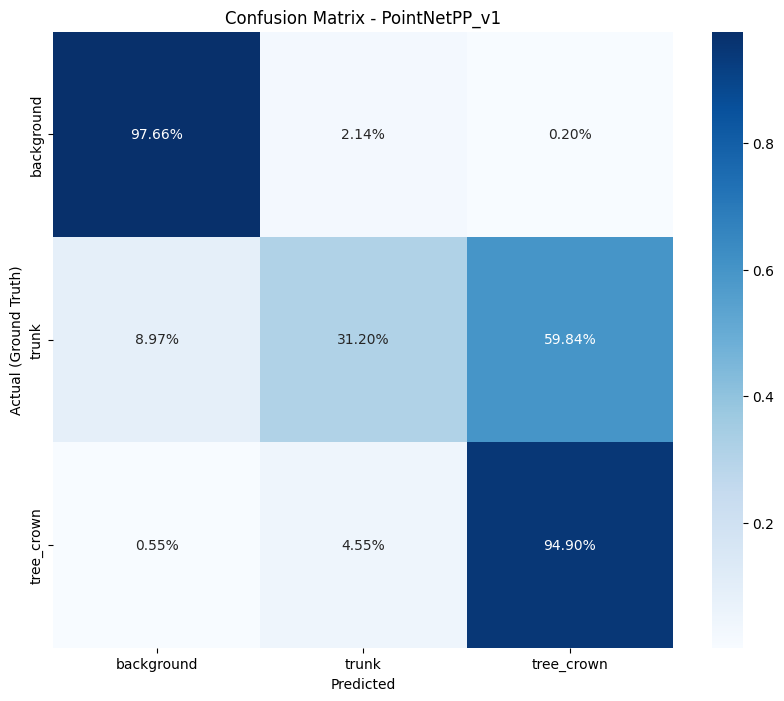 |  |

### Grupa 2: Architektura SpConv
| v1: Train Real | v2: Train Synth | v3: Train Real+Synth |
| :---: | :---: | :---: |
| 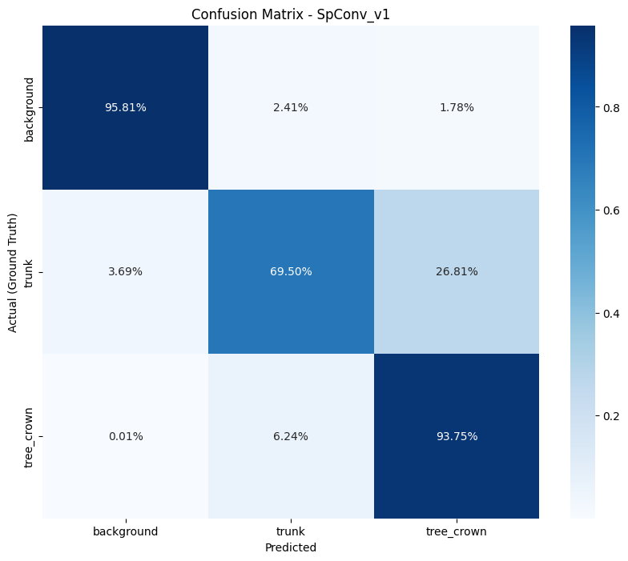 | 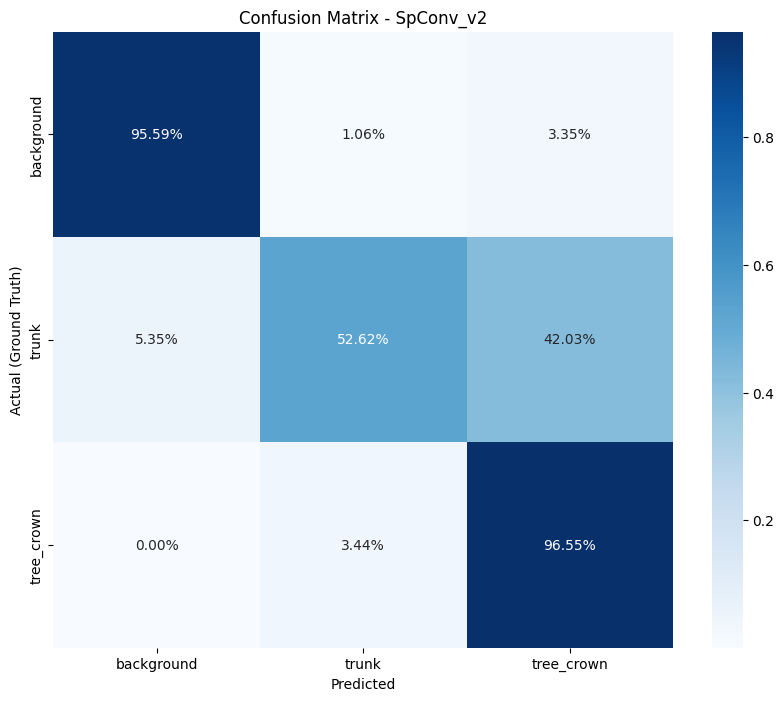 | 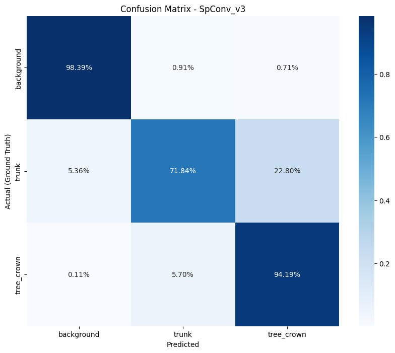 |

### Grupa 3: Architektura PTv3
| v1: Train Real | v2: Train Synth | v3: Train Real+Synth |
| :---: | :---: | :---: |
| 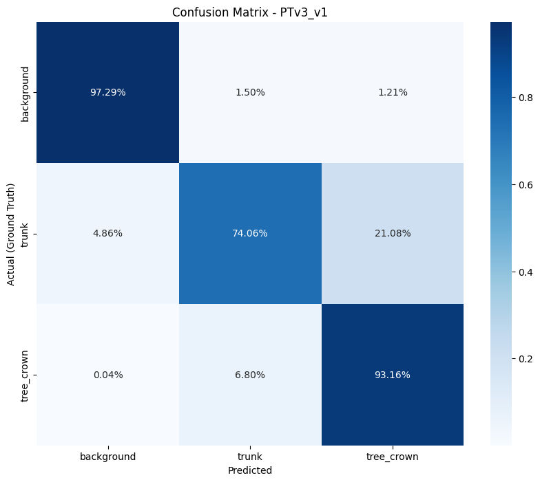 | 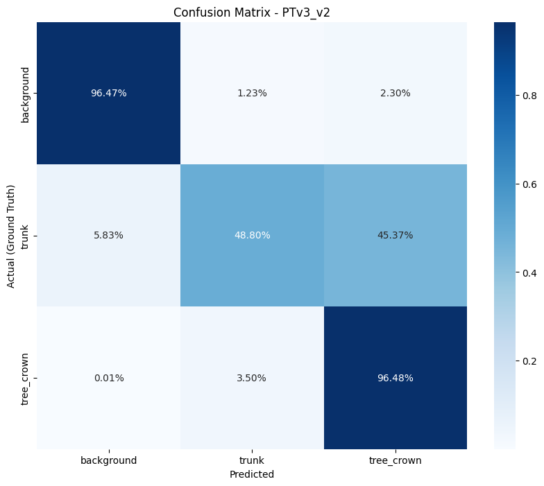 | 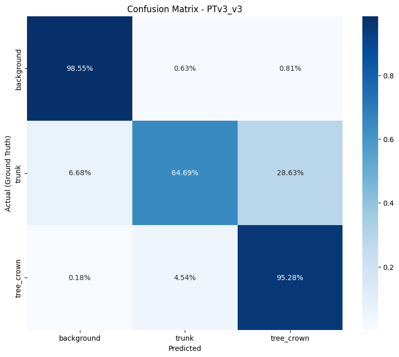 |

**Wnioski z porównania architektur (Real Only):**
*   **PointNet++**: Wykazuje najniższą użyteczność w detekcji pni (**Recall 31.20%**). Model masowo klasyfikuje punkty pnia jako koronę drzewa.
*   **PointNeXt**: Osiągnął wysoką czułość pnia (**Recall 73.00%**), zbliżoną do modeli SpConv czy PTv3. Jednak z uwagi na **znacząco dłuższy czas treningu** oraz wysoką konfuzję na styku korona-pień (8.62%), uznano go za rozwiązanie mniej efektywne od modeli rzadkich.
*   **Liderzy (SpConv i PTv3)**: Wykazały najlepszy stosunek precyzji do czasu obliczeń. **PTv3 (v1)** osiągnął najwyższy wynik wykrywania pni na danych naturalnych (**Recall 74.06%**).

### Analiza wpływu danych syntetycznych (v1 vs v3)
Wpływ danych syntetycznych na precyzję detekcji pni nie jest jednoznaczny i zależy od zastosowanej architektury:

*   **Degradacja w PTv3**: W modelu PTv3 dodanie danych syntetycznych (wariant v3) **pogorszyło** skuteczność wykrywania pni w porównaniu do treningu na samych danych rzeczywistych (spadek Recall z **74.06%** do **64.69%**). 
*   **Przyczyna (Sim-to-Real Gap)**: Wynik ten sugeruje, że mechanizm Attention w PTv3 jest bardzo czuły na "idealną" geometrię pni z generatora proceduralnego. Prawdopodbnie model uczy się zbyt sztywnych wzorców, które zawodzą przy nieregularnych, naturalnych pniach, co skutkuje częstszym myleniem pnia z dolnymi partiami korony (wzrost błędów z 21% na 28%).
*   **Stabilność SpConv**: Architektura splotowa SpConv wykazała większą odporność na wprowadzenie danych syntetycznych, odnotowując niewielką poprawę parametrów przy zbiorze hybrydowym.
*   **Rola ogólna**: Dane syntetyczne skutecznie stabilizują klasyfikację tła i korony, jednak w przypadku precyzyjnej detekcji pni ich nadmiar może wprowadzać niekorzystny schematyzm ograniczający generalizację modelu.

## 4.4. Notebooki Treningowe i Raporty WandB
Wszystkie notebooki treningowe zostały umiesczone w folderze 'training_notebooks'. Dodatkowo w celu zapewnienia pełnej transparentności całego procesu treningowego oraz umożliwienia analizy dynamiki uczenia, wszystkie sesje treningowe zostały zarejestrowane na platformie **Weights & Biases**. 

Raport zawiera szczegółowe przebiegi funkcji straty, zmianę metryk mIoU/F1 oraz wizualizacje segmentacji chmur punktów na różnych etapach optymalizacji wag.

**Dostęp do pełnych wyników eksperymentu:**  
[**Interaktywny Raport Badawczy (WandB)**](https://api.wandb.ai/links/lukslow/kihyww9l)

### Przykładowa dynamika uczenia (WandB)
Poniżej załączono dwa kluczowe zestawienia ilustrujące proces optymalizacji dla wszystkich testowanych architektur:

**Zestawienie zmian metryki mIoU w czasie treningu**  
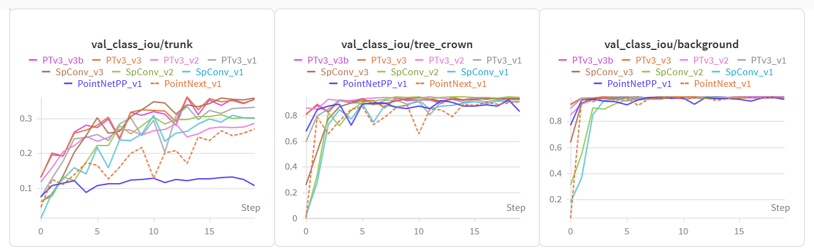
 <em>Wykres 1: Wzrost średniego IoU na zbiorze walidacyjnym.</em>

  

**Przebieg funkcji straty (Validation Loss)**  
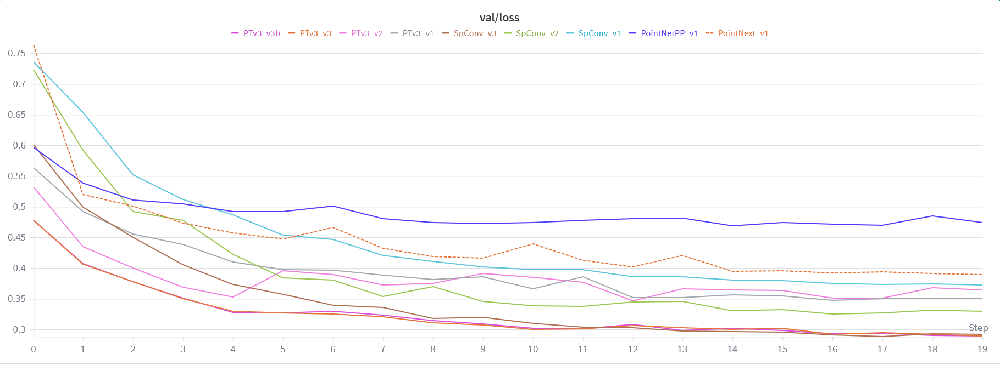
 <em>Wykres 2: Porównanie spadku straty walidacyjnej.</em>

---

# 5. Podsumowanie i Wnioski

Analiza powyższych wyników prowadzi do następujących obserwacji:

1.  Modele **PTv3** oraz **SpConv** wykazują zdecydowaną przewagę nad rozwiązaniami typu PointNet. PTv3 wykazuje najwyższy Recall dla klasy pnia (0.74 na zbiorze Real), natomiast SpConv oferuje najbardziej stabilne dopasowanie przestrzenne (IoU).
2.  Modele trenowane wyłącznie na syntetyku (Synth Only) osiągają bardzo wysokie IoU dla koron (nawet 0.94), jednak ich skuteczność w detekcji pni rzeczywistych jest ograniczona (IoU ok. 0.28).
3.  Redukcja gęstości danych do 50 pkt/m² nie degraduje znacząco metryk dla kluczowych struktur drzewa.
4.  **Ograniczenia metodyczne i charakter projektu**: Uzyskane wyniki oraz sformułowane wnioski odnoszą się do uproszczonego środowiska eksperymentalnego. Zastosowane losowe próbkowanie punktów stanowi model uproszczony względem rzeczywistej fizyki pomiarów LiDAR. Decyzja o agresywnym subsamplingu danych była świadomym założeniem projektowym, mającym na celu umożliwienie sprawnej i niskobudżetowej realizacji testów porównawczych kilku architektur.

---

# 6. Postprocessing i rekonstrukcja scen

Ostatnim etapem potoku przetwarzania było przywrócenie wyników segmentacji z postaci wycinków (patches) do pełnowymiarowych scen LiDAR. Proces ten zrealizowano w dwóch etapach przy użyciu dedykowanych notatników w katalogu `postprocess`.

## 6.1. Agregacja i stitching (`01_semantic_stitching.ipynb`)
Pierwszy etap polegał na scaleniu rozproszonych predykcji zapisanych w plikach `.npz` z powrotem w spójne sceny. Wykorzystując indeksy globalne, zsumowano i uśredniono logity dla punktów znajdujących się na zakładkach kafelków. Wynikiem tego procesu jest "rzadka" chmura punktów (ok. 50 pkt/m²), która bezpośrednio odzwierciedla dane, na których pracował model AI.

## 6.2. Propagacja etykiet i filtracja końcowa (`02_full_cloud_propagation.ipynb`)
Aby uzyskać wynik na oryginalnej gęstości skanu, wdrożono algorytm **KNN (Nearest Neighbor)** oparty na strukturze **KDTree**. 
*   **Propagacja**: Etykiety z chmury rzadkiej zostały przeniesione na wszystkie sąsiednie punkty oryginalnej, gęstej chmury wejściowej.
*   **Filtracja**: Na tym etapie automatycznie usunięto punkty sklasyfikowane pierwotnie jako klasa 3 (Out-points), co pozwoliło na wygenerowanie czystych scen zawierających wyłącznie teren, pnie oraz korony drzew.

### Wizualna weryfikacja efektów postprocessingu
Poniżej przedstawiono zestawienie wizualne predykcji modelu (wariant sparse) oraz efekt końcowy po propagacji (render wykonany w programie CloudCompare - https://www.cloudcompare.org/)

### Wizualne zestawienie wyników dla wybranych lokalizacji (2x2)

| **NIBIO** | **RMIT** |
| :---: | :---: |
| 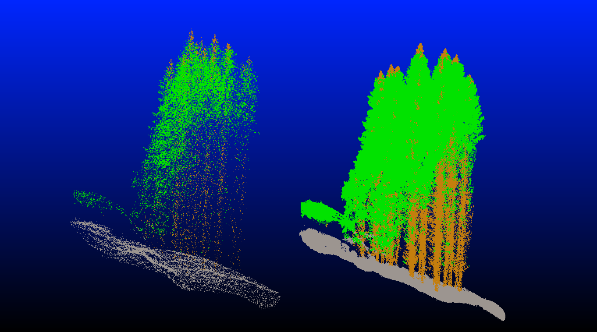 | 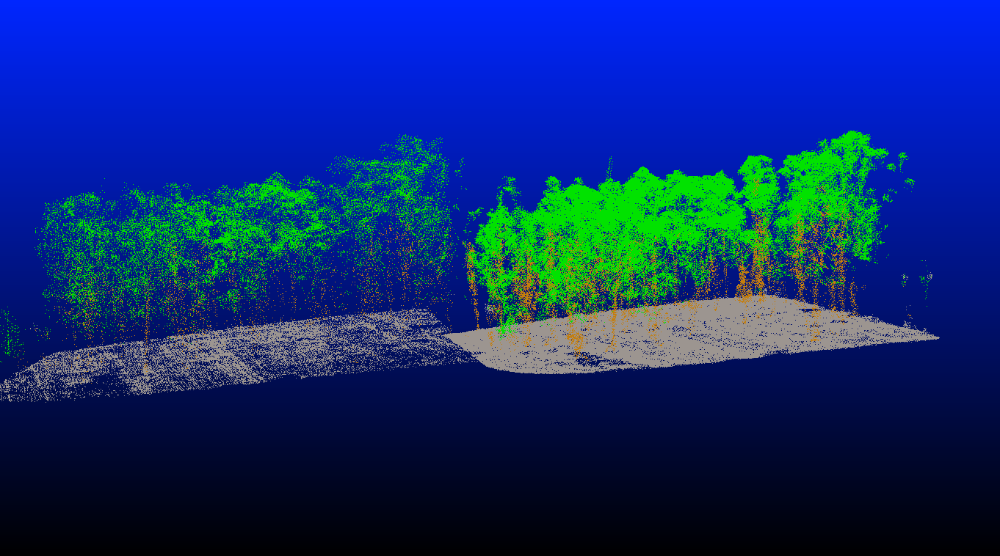 |
| **SCION** | **TUWIEN** |
| 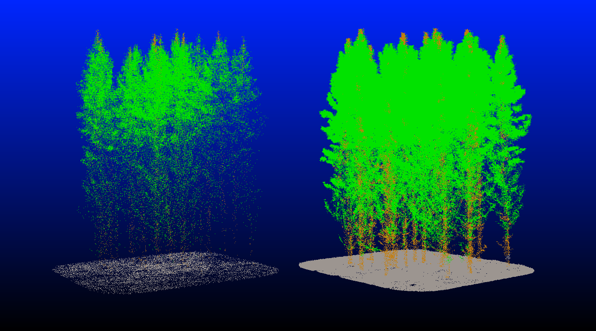 | 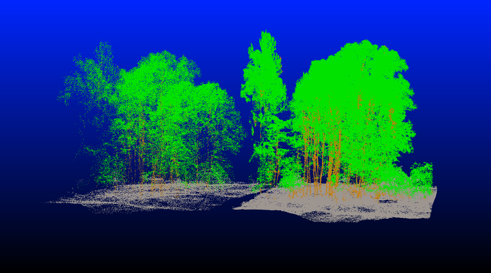 |

--- 

# 7. Wykorzystanie narzędzi AI oraz źródła kodu

Projekt został zrealizowany przy szerokim wsparciu technologii sztucznej inteligencji (głównie Gemini).

*   **Wsparcie koncepcyjne i merytoryczne**: Narzędzia AI były wykorzystywane jako partner w dyskusji na etapach projektowania metodologii
*   **Implementacja i debugowanie**: Modele AI brały czynny udział w generowaniu szkieletów kodu, tłumaczeniu dokumentacji technicznej specyficznych bibliotek (PTv3, SpConv) oraz w procesie czyszczenia i optymalizacji skryptów treningowych.
*   **Przygotowanie sprawozdania**: AI zostało wykorzystane do redakcji technicznej, tłumaczenia terminologii oraz strukturyzacji niniejszego raportu w formacie Markdown.
*   **Pochodzenie kodu i integracja**: Kod zaprezentowany w projekcie stanowi połączenie autorskich bloków kodu pochodzących z wcześniejszych prywatnych projektów oraz logiki wypracowanej wspólnie z AI. 

Podejście to pozwoliło na drastyczne przyspieszenie realizacji całego projektu.

---

# 8. Uwagi dotyczące zakresu testów i potencjału rozwoju

Przeprowadzone treningi miały charakter racej wstępny, liczba przetestowanych wariantów została ograniczona do kilku iteracji dla każdej architektury. Wypracowany pipelne posiada potencjał optymalizacyjny, a ewentualne dalsze testy najprawdopodobniej obejmowałyby:

*   **Zwiększenie gęstości danych**: Przetestowanie modeli na chmurach gęstszych niż obecne 50 pkt/m².
*   **Zmianę metody kafelkowania**: Zastosowanie cięcia cylindrycznego zamiast kwadratowego.
*   **Optymalizację procesu uczenia**: Szersze poszukiwanie optymalnych parametrów (Learning Rate, Batch Size) oraz testowanie różnych ustawień funkcji straty, optimizera czy wag dla klas semantycznych.
*   **Rozbudowę zbioru danych**: Zwiększenie różnorodności zarówno w zbiorze rzeczywistym, jak i syntetycznym.
*   **Dalsze poprawki/optymalizacje w kodzie.**
