

# Comparative Analysis of Selected Deep Learning Architectures for Semantic Segmentation of LiDAR Point Clouds in Forestry, including the Impact of Synthetic and Real Data

**Authors:**  
Łukasz Słowik, Karol Pietruszka

---

**Subject:** Introduction to Artificial Intelligence  
**Field of Study:** Geomatics and AI in Forestry  
**Date:** June/July 2026

---

# 1. Data Preparation

The data preparation process for this project involved the integration of real-world LiDAR point clouds with synthetic datasets and their structured division into processing subsets.

## 1.1. Utilized Data

Two primary data sources were used in the project:

1.  **ForInstance v1 Dataset**: 
    *   Data Repository: [Zenodo (8287792)](https://zenodo.org/records/8287792)
    *   Article: [arXiv:2309.01279](https://arxiv.org/pdf/2309.01279)
2.  **Synthetic Dataset**:
    *   **Generation Environment**: 3D graphics suite [Blender](https://www.blender.org/) controlled by a custom Python script.
    *   **Object Geometry**: 3D tree models generated in [TreeIt](https://www.evolved-software.com/treeit/treeit) software were used to construct the scenes.

## 1.2. Training, Validation, and Test Split:

The ForInstance v1 dataset was divided into three parts: training, validation, and testing. The split did not focus on the specific characteristics of each individual scene; instead, it ensured that each data package (CULS, NIBIO, RMIT, SCION, TUWIEN) was represented in the training and validation/testing sets.

### 1.2.1. Training Subset (TRAIN) – 19 scenes

*   CULS_plot_1_annotated.las
*   NIBIO_plot_1_annotated.las
*   NIBIO_plot_2_annotated.las
*   NIBIO_plot_4_annotated.las
*   NIBIO_plot_5_annotated.las
*   NIBIO_plot_7_annotated.las
*   NIBIO_plot_8_annotated.las
*   NIBIO_plot_10_annotated.las
*   NIBIO_plot_11_annotated.las
*   NIBIO_plot_13_annotated.las
*   NIBIO_plot_16_annotated.las
*   NIBIO_plot_18_annotated.las
*   NIBIO_plot_19_annotated.las
*   NIBIO_plot_22_annotated.las
*   RMIT_train.las
*   SCION_plot_31_annotated.las
*   SCION_plot_39_annotated.las
*   SCION_plot_87_annotated.las
*   TUWIEN_train.las

### 1.2.2. Validation Subset (VAL) – 4 scenes
*   NIBIO_plot_3_annotated.las
*   NIBIO_plot_9_annotated.las
*   NIBIO_plot_17_annotated.las
*   SCION_plot_35_annotated.las

### 1.2.3. Test Subset (TEST) – 7 scenes
*   NIBIO_plot_12_annotated.las
*   NIBIO_plot_21_annotated.las
*   NIBIO_plot_23_annotated.las
*   NIBIO_plot_6_annotated.las
*   RMIT_test.las
*   SCION_plot_61_annotated.las
*   TUWIEN_test.las

---

# 2. Preprocessing

The training data preparation process was implemented via four Jupyter notebooks located in the `preprocessing` directory.

## 2.1. Notebook 01: Data Indexing (`01_data_indexing`)
The first stage involved assigning a unique identifier (ID) to each point within the data package to ensure correlation between input points and segmentation results. Ultimately, this approach serves to map prediction results back to the original point clouds during the post-processing stage.

## 2.2. Notebook 02: Dataset Tiling (`02_data_tiling.ipynb`)
This stage involved dividing the scenes into smaller patches/tiles for processing by neural networks.

### Geometric Tiling Parameters:
*   **Tile Size (PATCH_SIZE)**: 20.0 m x 20.0 m.
*   **Stride**: 10.0 m (50% overlap between adjacent tiles).
*   **Method**: Basic square grid tiling, without advanced filtering of boundary objects.

### Point Selection and Filtering:
*   **Exclusion of Class 3 (Out-points)**: Points classified as "Out Points" (https://arxiv.org/pdf/2309.01279) were removed. These often represented fragments of trees (and in some cases, nearly entire trees) on the edges of the scenes.
*   **Density Limits (MIN/MAX_TOTAL_POINTS)**: 
    *   Tiles containing fewer than **100 points** were discarded as statistically insignificant.
    *   For tiles exceeding **50,000 points**, random subsampling was applied to reduce data size.

## 2.3. Notebook 03: Semantic Relabeling (`03_data_relabeling.ipynb`)
The original data classification (7 classes) was simplified into a 3-class target model.

**Label Mapping Scheme:**

| Original Class Code | Original Class Name | New Class Code | Target Class Name |
| :--- | :--- | :---: | :--- |
| 0, 1, 2 | Unclassified, Low-veg, Terrain | **0** | **Background** |
| 4 | Stem | **1** | **Trunk** |
| 5, 6 | Live branches, Woody branches | **2** | **Tree Crown** |

*Class 3 (Out-points) was permanently removed during the tiling stage.*

## 2.4. Notebook 04: Dataset Verification (`04_dataset_check.ipynb`)
The final stage was a qualitative check of the processed data by generating 3D projections using the Matplotlib library. The script allows for visual verification of labeling correctness and class mapping, as shown in the illustration below.

  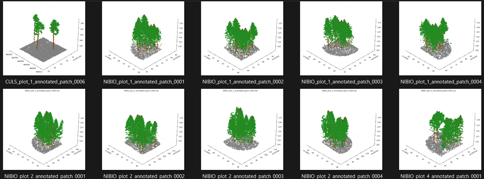
   
  <em>Verification of labeling correctness and tile consistency.</em>

---

# 3. Environment and Training Process

The model training process was designed for flexibility and the ability to test various architectures within a budget-limited computing environment.

## 3.1. Computing Platform and Infrastructure

The primary computing environment was the **Paperspace Gradient** platform (https://www.paperspace.com/). This choice was driven by the ability to work on a "clean" Ubuntu system, which was crucial for the correct compilation and installation of specific 3D libraries.

*   **Main Platform**: Paperspace ("Start from Scratch" machine).
*   **Additional Support**: Google Colab (requires path adjustment in the 'System Setup' section of the notebook; only supports PointNext and PointNet++ backbones).
*   **Hardware Specification**:
    *   **GPU**: NVIDIA Quadro RTX 5000 (Turing Architecture, sm_75, 16GB VRAM).
    *   **CUDA**: Version 12.4.
*   **Configuration**: A detailed description of the environment setup (driver and dependency installation) is included in a separate document: `paperspace_environment_setup.md`.

## 3.2. Utilized Libraries

The core of the training system was based on three key libraries dedicated to point cloud processing and sparse data structures:

1.  **PyTorch Geometric (https://github.com/pyg-team/pytorch_geometric)**: Used for most tasks related to data preparation, spatial transformation implementation, and Dataloader construction.
2.  **SpConv (https://github.com/traveller59/spconv)**: Used as the engine for the backbone based on 3D Sparse Convolutions.
3.  **PointTransformerV3 (https://github.com/pointcept/pointtransformerv3)**: Used as the engine for the PTv3-based backbone.

## 3.3. Training Notebook Objectives

The main objective of the developed notebook was to create a modular environment for rapid prototyping and testing of different neural network variants. The system allows for easy modification of:
*   Network architecture (backbone).
*   Model size (channel count, network depth).
*   Training hyperparameters within the scope of semantic tree segmentation.

## 3.4. Architecture and Experiment Configuration (`CFG_DICT`)

The training system was fully parameterized using a configuration dictionary `CFG_DICT` to ensure experiment reproducibility and convenient switching between architectures.

### 3.4.1. Backbone Modularity
The notebook supports four technologically diverse architectures:
*   **PointNet++**: Utilizing *Set Abstraction* and *Feature Propagation* modules with manual FPS (*Farthest Point Sampling*) and KNN implementation.
*   **PointNeXt**: An evolved version of PointNet++, introducing *Inverted Residual* blocks.
*   **SpConv**: Architecture based on Sparse Convolutions.
*   **PTv3 (Point Transformer v3)**: A model utilizing the Attention mechanism.

### 3.4.2. Optimization Strategy and Objective Functions
Gradient stabilization mechanisms were implemented during the learning process:
*   **Loss Function (DiceFocalLoss)**: A hybrid combination of *Focal Loss* (focusing on hard points, e.g., trunks) and *Dice Loss* (optimizing global class overlap/IoU). *Label Smoothing* (0.15) was also applied for better generalization.
*   **Optimizer**: AdamW with weight decay.
*   **Scheduler**: `CosineAnnealingLR` preceded by a 5-epoch *Warmup* stage.

## 3.5. Domain-Specific Augmentation

The project includes an augmentation pipeline specifically adapted to the characteristics of LiDAR data in forestry. In addition to standard rotations and scaling, transformations simulating real terrain conditions were implemented (focusing on semantic transformations; individual instance modifications were omitted):
*   **Random Slope**: Simulation of terrain inclination.
*   **Semantic Stem Stretch**: Dynamic stretching of tree trunks while maintaining consistency with the crown.
*   **Class Local Density Change**: Random reduction of point density within specific classes (e.g., sparser points on the trunk), simulating varying scanning conditions.
*   **Forest Geometry Thickener**: Selective densification of the "trunk" class points through jittering, aimed at strengthening the geometric representation of the most challenging class.
*   **Elastic Distortion**: Non-linear spatial deformations of the point cloud.

Examples of augmentation are attached below:

**Augmentation Example 1**  
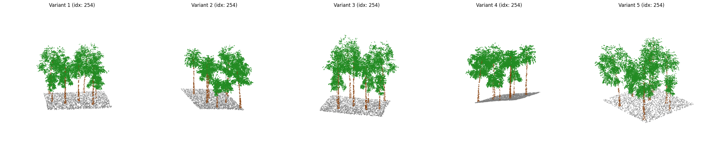

**Augmentation Example 2**  
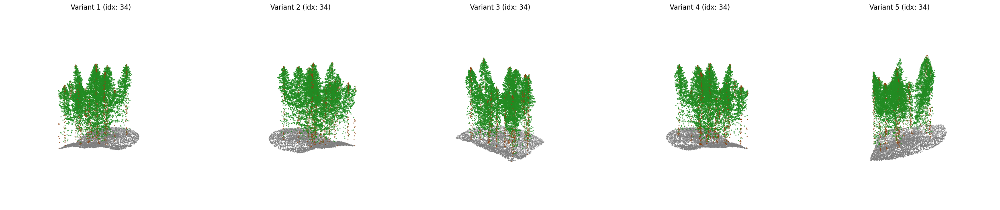

**Augmentation Example 3**  
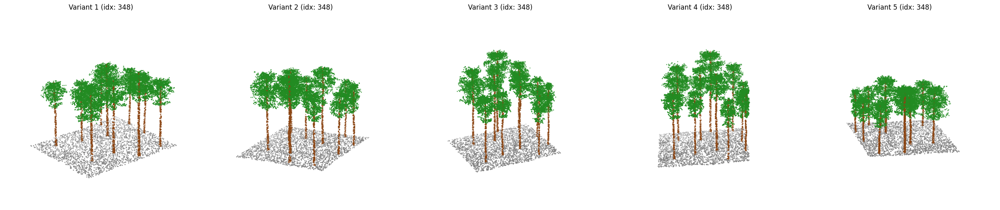

## 3.6. Monitoring and Logging (Weights & Biases)

The training process is fully integrated with the **Weights & Biases (WandB)** platform. The system logs in real-time:
*   Segmentation metrics: mIoU, F1-score, Precision, and Recall (both global and per-class).
*   3D Visualizations.
*   Checkpointing: Automatic saving of model weights for the best `val/mIoU` metric result.

## 3.7. Scope of Experiments and Limitations

Due to the pilot nature of the project and time constraints, a selective number of training sessions were conducted. The hyperparameter optimization process focused on key parameters (learning rate, batch size) and involved only a few training runs.

*   **PointNet++ and PointNeXt**: These models underwent single test attempts (mainly due to relatively long training times and, in the case of PointNet++, poor results).
*   **SpConv and PTv3**: Additionally, single tests were performed using the synthetic dataset for training, as well as a combination of synthetic and real datasets.

---

# 4. Results and Experimental Analysis

This section presents a summary of the results obtained for the tested model configurations. The analysis covers both the test set (7 scenes) and the validation set (4 scenes).

## 4.1. Detailed Results on the Test Set (7 scenes)

The following table contains classification reports for the three defined classes: Background (0), Trunk (1), and tree_crown (2).

| Model | Dataset | Class | Precision | Recall | F1-score | Accuracy |
| :--- | :--- | :--- | :---: | :---: | :---: | :---: |
| **PointNet++** | Real | background | 0.9649 | 0.9766 | 0.9707 | **0.9265** |
| | | trunk | 0.2702 | 0.3120 | 0.2896 | |
| | | tree_crown | 0.9618 | 0.9490 | 0.9553 | |
| **PointNext** | Real | background | 0.9878 | 0.9677 | 0.9777 | **0.9167** |
| | | trunk | 0.3245 | 0.7300 | 0.4493 | |
| | | tree_crown | 0.9814 | 0.9122 | 0.9455 | |
| **SpConv** | Real | background | 0.9921 | 0.9581 | 0.9748 | **0.9314** |
| | | trunk | 0.3782 | 0.6950 | 0.4898 | |
| | | tree_crown | 0.9771 | 0.9375 | 0.9569 | |
| **SpConv** | Synth | background | 0.9889 | 0.9559 | 0.9721 | **0.9437** |
| | | trunk | 0.4609 | 0.5262 | 0.4914 | |
| | | tree_crown | 0.9639 | 0.9655 | 0.9647 | |
| **SpConv** | **Real+Synth** | background | 0.9858 | 0.9839 | 0.9849 | **0.9415** |
| | | trunk | 0.4238 | 0.7184 | 0.5332 | |
| | | tree_crown | 0.9831 | 0.9419 | 0.9621 | |
| **PTv3** | Real | background | 0.9891 | 0.9729 | 0.9809 | **0.9324** |
| | | trunk | 0.3842 | 0.7406 | 0.5059 | |
| | | tree_crown | 0.9824 | 0.9316 | 0.9563 | |
| **PTv3** | Synth | background | 0.9877 | 0.9647 | 0.9760 | **0.9433** |
| | | trunk | 0.4375 | 0.4880 | 0.4614 | |
| | | tree_crown | 0.9647 | 0.9648 | 0.9648 | |
| **PTv3** | **Real+Synth** | background | 0.9811 | 0.9855 | 0.9833 | **0.9465** |
| | | trunk | 0.4565 | 0.6469 | 0.5353 | |
| | | tree_crown | 0.9793 | 0.9528 | 0.9659 | |

## 4.2. Aggregate Validation Results (4 scenes)

Metrics obtained on the validation set (WandB Run Summary). Due to the high scores for the background and crown classes, the mIoU of the Trunk class appears to be the key indicator.

| Model | Dataset | Val Acc | Val mF1 | Val mIoU | IoU Bkgr. | IoU Crown | IoU Trunk |
| :--- | :--- | :---: | :---: | :---: | :---: | :---: | :---: |
| **PointNet++** | Real | 0.8559 | 0.6944 | 0.6349 | 0.9701 | 0.8282 | 0.1065 |
| **PointNext** | Real | 0.9207 | 0.7888 | 0.7187 | 0.9814 | 0.9041 | 0.2706 |
| **SpConv** | Real | 0.9212 | 0.8015 | 0.7294 | 0.9822 | 0.9040 | 0.3021 |
| **SpConv** | Synth | 0.9474 | 0.8059 | 0.7385 | 0.9785 | 0.9376 | 0.2993 |
| **SpConv** | **Real+Synth** | 0.9436 | **0.8281** | **0.7577** | 0.9825 | 0.9314 | **0.3593** |
| **PTv3** | Real | 0.9337 | 0.8161 | 0.7451 | 0.9840 | 0.9193 | 0.3320 |
| **PTv3** | Synth | **0.9492** | 0.8010 | 0.7350 | 0.9794 | **0.9402** | 0.2856 |
| **PTv3** | **Real+Synth** | 0.9448 | **0.8274** | **0.7579** | **0.9854** | 0.9332 | 0.3550 |

## 4.3. Confusion Matrix Analysis

The following section presents a compilation of confusion matrices (7 test scenes) for all tested variants, grouped by architecture and dataset used.

### Group 1: Baseline Architectures
| PointNet++ (Real) | PointNeXt (Real) |
| :---: | :---: |
| 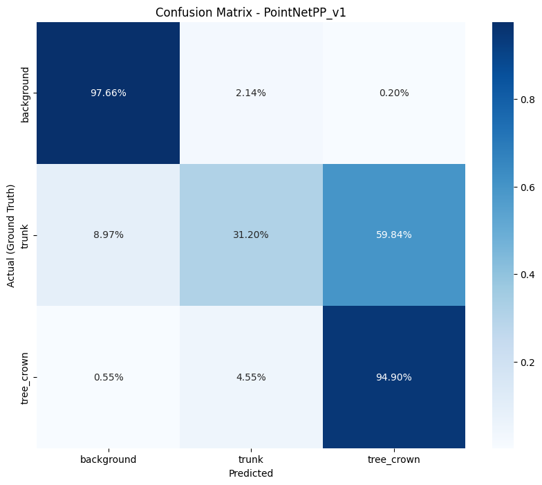 |  |

### Group 2: SpConv Architecture
| v1: Train Real | v2: Train Synth | v3: Train Real+Synth |
| :---: | :---: | :---: |
| 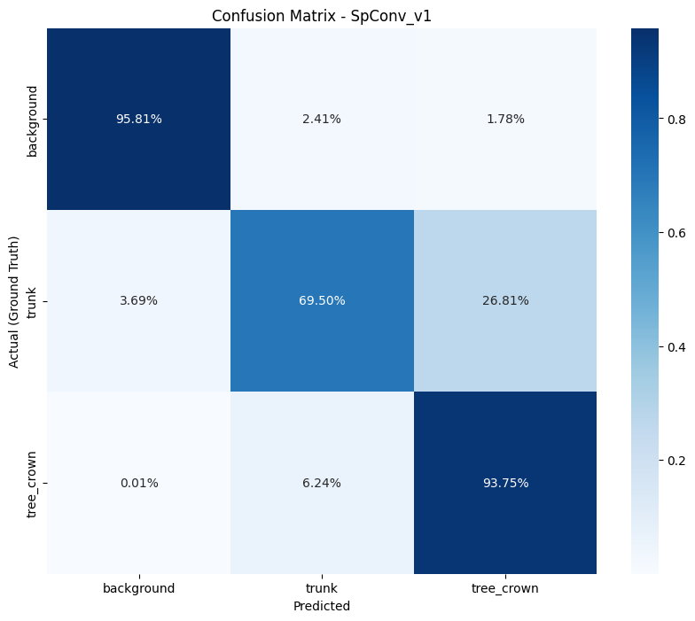 | 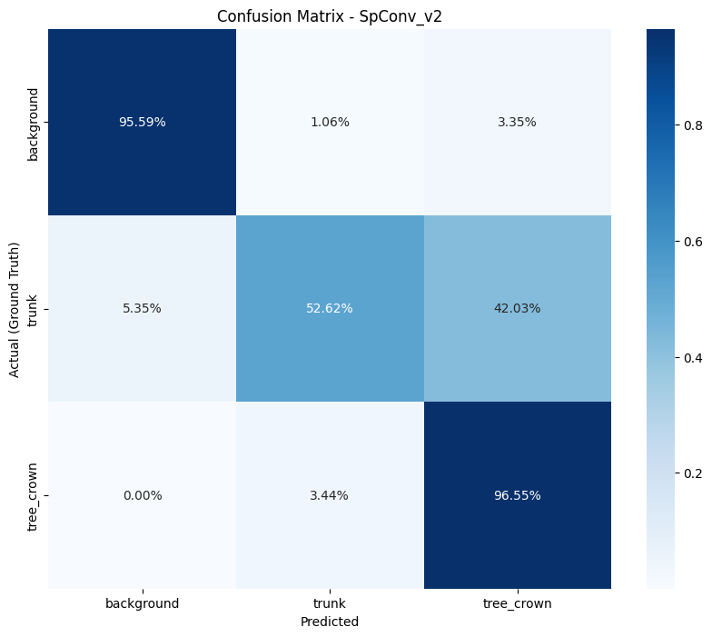 | 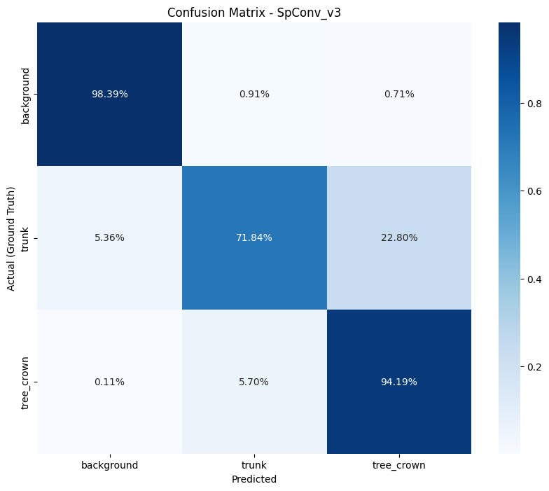 |

### Group 3: PTv3 Architecture
| v1: Train Real | v2: Train Synth | v3: Train Real+Synth |
| :---: | :---: | :---: |
| 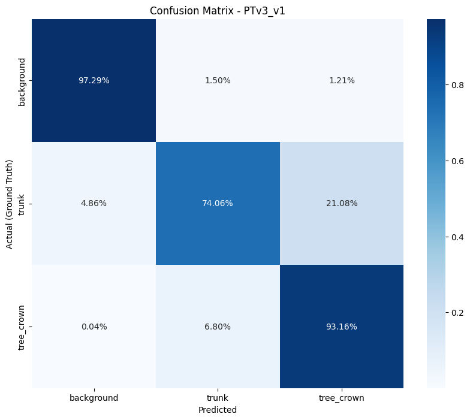 | 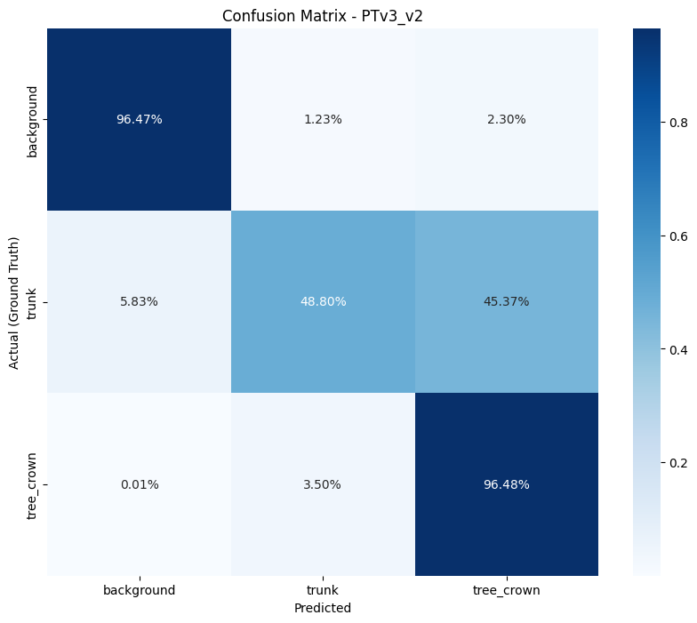 | 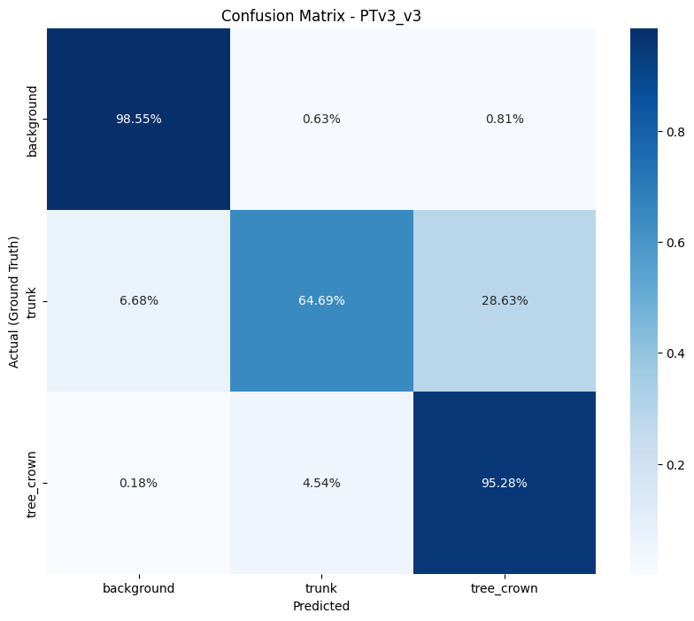 |

**Conclusions from Architecture Comparison (Real Only):**
*   **PointNet++**: Exhibits the lowest utility in trunk detection (**Recall 31.20%**). The model extensively misclassifies trunk points as tree crowns.
*   **PointNeXt**: Achieved high trunk sensitivity (**Recall 73.00%**), comparable to SpConv or PTv3 models. However, due to **significantly longer training times** and high confusion at the crown-trunk interface (8.62%), it was considered less efficient than sparse models.
*   **Leaders (SpConv and PTv3)**: Showed the best precision-to-compute ratio. **PTv3 (v1)** achieved the highest trunk detection result on natural data (**Recall 74.06%**).

### Analysis of the Impact of Synthetic Data (v1 vs v3)
The impact of synthetic data on trunk detection precision is not clear-cut and depends on the architecture used:

*   **Degradation in PTv3**: In the PTv3 model, adding synthetic data (variant v3) **worsened** trunk detection effectiveness compared to training on real data alone (Recall dropped from **74.06%** to **64.69%**).
*   **Root Cause (Sim-to-Real Gap)**: This result suggests that the Attention mechanism in PTv3 is highly sensitive to the "ideal" geometry of trunks from the procedural generator. The model likely learns rigid patterns that fail with irregular, natural trunks, resulting in more frequent confusion between the trunk and the lower parts of the crown (error rate increased from 21% to 28%).
*   **SpConv Stability**: The SpConv convolutional architecture showed greater resilience to the introduction of synthetic data, noting a slight improvement in parameters with the hybrid dataset.
*   **General Role**: Synthetic data effectively stabilizes background and crown classification; however, for precise trunk detection, an excess of such data may introduce an unfavorable schematism that limits model generalization.

## 4.4. Training Notebooks and WandB Reports
All training notebooks have been placed in the 'training_notebooks' folder. Additionally, to ensure full transparency of the training process and allow for analysis of learning dynamics, all sessions were recorded on the **Weights & Biases** platform.

The report includes detailed loss function curves, changes in mIoU/F1 metrics, and 3D point cloud segmentation visualizations at various stages of weight optimization.

**Access to full experiment results:**  
[**Interactive Research Report (WandB)**](https://api.wandb.ai/links/lukslow/kihyww9l)

### Example Learning Dynamics (WandB)
Below are two key summaries illustrating the optimization process for all tested architectures:

**Comparison of mIoU Metric Changes During Training**  
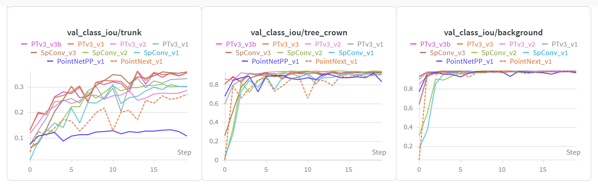
 <em>Chart 1: Increase in Mean IoU on the validation set.</em>

  

**Loss Function Curves (Validation Loss)**  
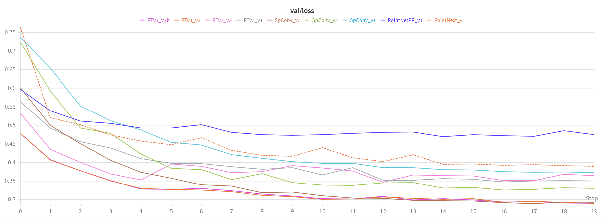
 <em>Chart 2: Comparison of validation loss decrease.</em>

---

# 5. Summary and Conclusions

Analysis of the above results leads to the following observations:

1.  **PTv3** and **SpConv** models show a clear advantage over PointNet-type solutions. PTv3 shows the highest Recall for the trunk class (0.74 on the Real set), while SpConv offers the most stable spatial fit (IoU).
2.  Models trained exclusively on synthetic data (Synth Only) achieve very high IoU for crowns (up to 0.94), but their effectiveness in detecting real trunks is limited (IoU approx. 0.28).
3.  Reducing data density to 50 pts/m² does not significantly degrade metrics for key tree structures.
4.  **Methodological Limitations and Project Nature**: The results obtained and conclusions formulated refer to a simplified experimental environment. The applied random point sampling is a simplified model compared to real LiDAR measurement physics. The decision for aggressive data subsampling was a deliberate project assumption aimed at enabling efficient and low-budget comparative testing of several architectures.

---

# 6. Post-processing and Scene Reconstruction

The final stage of the processing pipeline was to restore the segmentation results from patches to full-scale LiDAR scenes. This process was carried out in two stages using dedicated notebooks in the `postprocess` directory.

## 6.1. Aggregation and Stitching (`01_semantic_stitching.ipynb`)
The first stage involved merging scattered predictions stored in `.npz` files back into coherent scenes. Using global indices, logits for points located on tile overlaps were summed and averaged. The result of this process is a "sparse" point cloud (approx. 50 pts/m²) that directly reflects the data the AI model worked on.

## 6.2. Label Propagation and Final Filtration (`02_full_cloud_propagation.ipynb`)
To obtain results at the original scan density, a **KNN (Nearest Neighbor)** algorithm based on a **KDTree** structure was implemented.
*   **Propagation**: Labels from the sparse cloud were transferred to all neighboring points of the original, dense input cloud.
*   **Filtration**: At this stage, points originally classified as Class 3 (Out-points) were automatically removed, allowing for the generation of clean scenes containing only terrain, trunks, and tree crowns.

### Visual Verification of Post-processing Effects
Below is a visual comparison of the model's prediction (sparse variant) and the final effect after propagation (render performed in CloudCompare - https://www.cloudcompare.org/).

### Visual Result Summary for Selected Locations (2x2)

| **NIBIO** | **RMIT** |
| :---: | :---: |
| 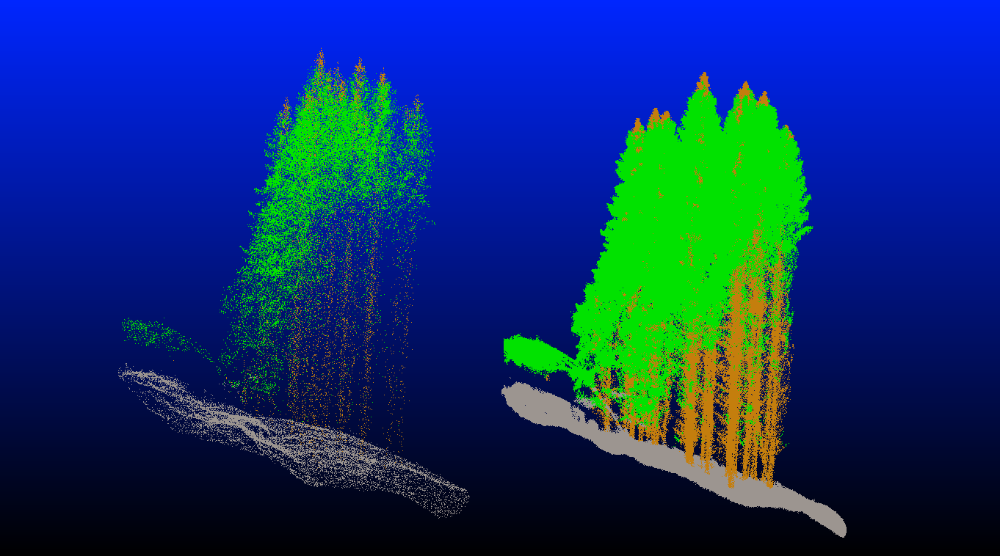 | 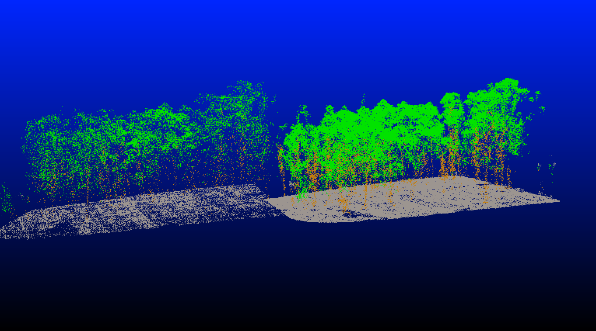 |
| **SCION** | **TUWIEN** |
| 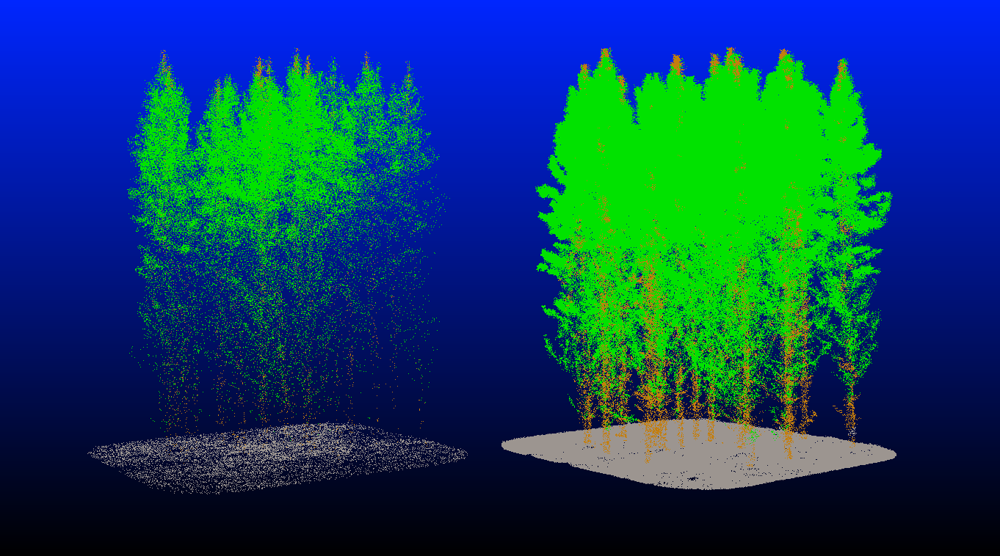 | 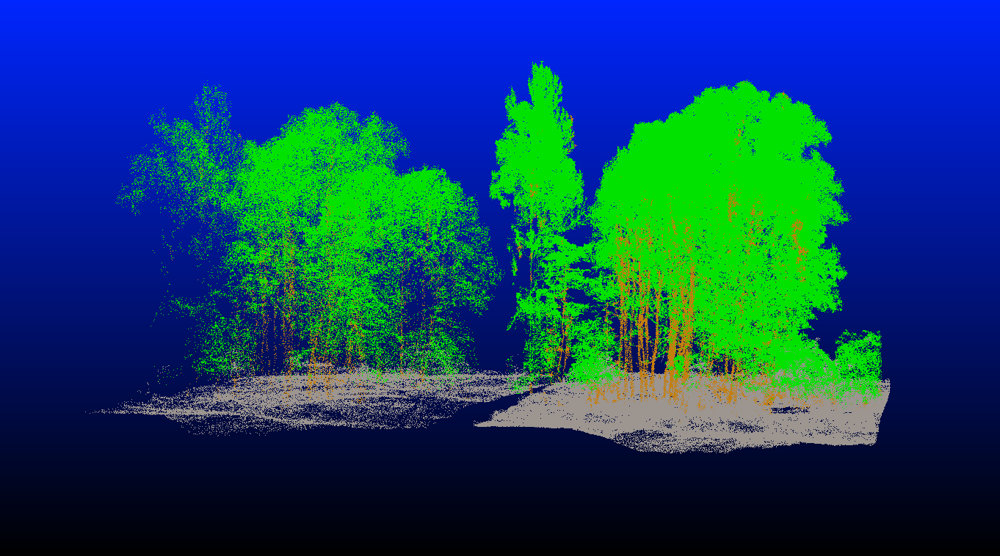 |

--- 

# 7. Use of AI Tools and Code Sources

The project was implemented with extensive support from Artificial Intelligence technologies (primarily Gemini).

*   **Conceptual and Substantive Support**: AI tools were used as a partner in discussion during the methodology design stages.
*   **Implementation and Debugging**: AI models actively participated in generating code skeletons, translating technical documentation for specific libraries (PTv3, SpConv), and in the process of cleaning and optimizing training scripts.
*   **Report Preparation**: AI was used for technical editing, terminology translation, and structuring this report in Markdown format.
*   **Code Provenance and Integration**: The code presented in the project is a combination of original code blocks from previous private projects and logic developed jointly with AI.

This approach allowed for a drastic acceleration of the entire project's realization.

---

# 8. Notes on Test Scope and Development Potential

The conducted training sessions were rather preliminary; the number of tested variants was limited to a few iterations for each architecture. The developed pipeline has optimization potential, and eventual further testing would likely include:

*   **Increasing Data Density**: Testing models on clouds denser than the current 50 pts/m².
*   **Changing Tiling Method**: Applying cylindrical cutting instead of square cutting.
*   **Optimization of the Learning Process**: Broader search for optimal parameters (Learning Rate, Batch Size) and testing different settings for loss functions, optimizers, or weights for semantic classes.
*   **Expansion of the Dataset**: Increasing diversity in both real and synthetic sets.
*   **Further Code Improvements/Optimizations.**