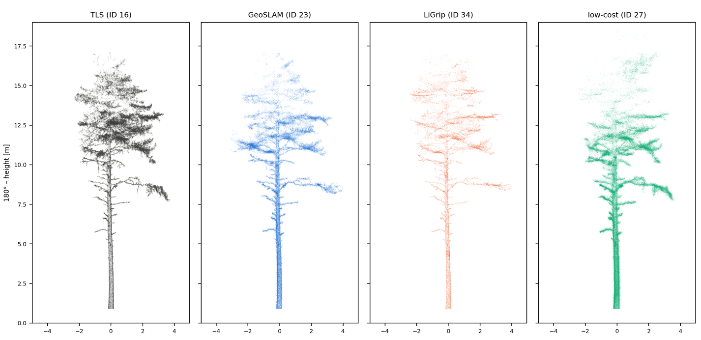
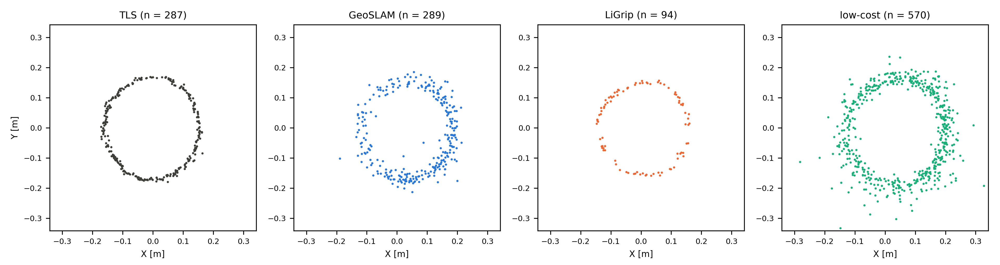

# GeoAI Postgraduate Portfolio

This repository contains final projects completed during the **"Geomatics and Artificial Intelligence in Forestry"** postgraduate program at the [Forest Research Institute (IBL)](https://www.ibles.pl/studia-podyplomowe-gematyka-i-sztuczna-inteligencja-w-lesnictwie/).

The projects focus on the application of spatial data analysis, remote sensing, and deep learning in forest management and environmental monitoring.

---

## Project Overview

### 1. Spatial Databases (`2_1_spatial_databases`)
**Title:** Managing Tree-Related Hazards to Infrastructure  
**Description:** Implementation of a spatial database system designed to identify and manage "danger trees" that pose a threat to technical infrastructure. Focuses on spatial queries and hazard risk assessment.

Examples of results:

  
  
  

### 2. R Programming (`2_2_r_programming`)
**Title:** Forest Stand Change Analysis (Piwniczna Forest District)  
**Description:** An automated data processing pipeline in R used to analyze and visualize changes in forest inventory data (BDL) over a 10-year cycle (2015–2025).

Examples of results:

  
  

### 3. Python Programming (`3_python_programming`)
**Title:** Monitoring Forest Disturbance and Recovery Dynamics in the Greater Blue Mountains Area  
**Description:** A multi-temporal NDVI analysis focusing on the impact and recovery of the 2019/2020 "Black Summer" fires in Australia. The project utilizes Python for satellite imagery processing and trend visualization.

Examples of results:

  

  

### 4. Introduction to Artificial Intelligence (`4_introduction_to_artificial_intelligence`)
**Title:** Semantic Segmentation of LiDAR Point Clouds in Forestry  
**Description:** A comparative analysis of state-of-the-art Deep Learning architectures (PointNet++, SpConv, and Point Transformer v3) for tree trunk and crown segmentation. Includes an analysis of the impact of synthetic vs. real-world training data.

Examples of results:

  

  

  

  

### 5. Forest Point Clouds (`5_CRRS`)
**Title:** Benchmarking Handheld Laser Scanners against TLS in a Forest Plot  
**Description:** Comparison of three handheld laser scanners (GeoSLAM ZEB Horizon, LiGrip and a low-cost device) with terrestrial laser scanning (Trimble X7) on a plot with dense understorey: tree detection and DBH, height and volume from Arbor, stem diameter profiles from 3DFin, and visual comparison of the same trees across point clouds. Includes a Python pipeline for 1:1 tree matching (Hungarian algorithm) and bias/RMSE analysis.

Examples of results:

  

  

---

## Technologies & Tools
*   **Languages:** Python, R, SQL
*   **AI/ML:** PyTorch, PyTorch Geometric, SpConv, Pointcept
*   **GIS/Spatial:** PostGIS, QGIS, LiDAR (las/laz), Multispectral Imagery (NDVI)
*   **Environment:** Jupyter Notebooks, RStudio, Paperspace Gradient
*   **Point clouds:** TLS and handheld laser scanning, Arbor, 3DFin, CloudCompare, laspy
